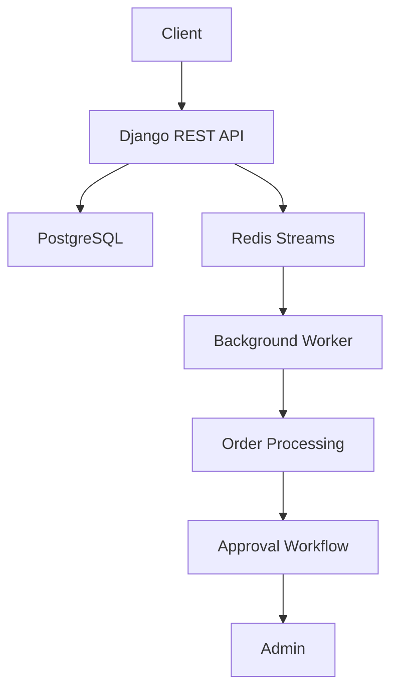

# Event-Driven Order Processing System

  <strong>A backend architecture case study demonstrating asynchronous processing, event-driven design, reliability patterns, and controlled order workflows.</strong>

---

## Overview

This project presents a proposed backend architecture for processing orders asynchronously using Django REST Framework, Redis Streams, PostgreSQL, and Docker.

The system is designed to separate API request handling from background processing while introducing controlled approval workflows, event-driven communication, and reliability considerations.

> **Project Status:** Architecture & Documentation Case Study  
> This repository contains architectural documentation and design decisions. It is not presented as a fully implemented or production-deployed application.

---

## Architecture

---

## Core Workflow

1. Client submits an order through the API.
2. API validates the request.
3. Order is persisted with an initial status.
4. An event is published to Redis Streams.
5. A background worker consumes and processes the event.
6. The order transitions to an approval-pending state.
7. An authorized administrator approves or rejects the order.
8. The order reaches its final state.

---

## Engineering Focus

- Event-driven architecture
- Asynchronous background processing
- Redis Streams and consumer groups
- REST API design
- Transactional data management
- Idempotent event processing
- Retry and failure recovery
- Order lifecycle and state management
- Role-based access control
- Scalability and observability
- Docker-based infrastructure

---

## Technology Stack

| Technology | Purpose |
|---|---|
| Python | Backend programming language |
| Django REST Framework | REST API and application layer |
| PostgreSQL | Relational database |
| Redis Streams | Event messaging |
| Background Workers | Asynchronous processing |
| Docker | Containerization |

---

## Architecture Documentation

| Document | Description |
|---|---|
| [System Architecture](docs/architecture.md) | Components and architectural design |
| [Architecture Diagram](docs/architecture-diagram.md) | Visual system architecture |
| [Order Workflow](docs/order-workflow.md) | Order lifecycle and state transitions |
| [Technical Decisions](docs/technical-decisions.md) | Technology choices and trade-offs |
| [Production Considerations](docs/production-considerations.md) | Security, reliability, deployment, monitoring |

---

## Reliability Considerations

The proposed design explores:

- Duplicate event handling
- Idempotent processing
- Retry strategies
- Worker failure recovery
- Pending message recovery
- Database transaction integrity
- Monitoring and alerting
- Unauthorized state transition prevention

---

## Future Improvements

- Implement API endpoints and serializers.
- Add Redis Streams consumer groups.
- Implement worker retry and recovery mechanisms.
- Add automated tests.
- Add authentication and role-based authorization.
- Introduce monitoring and structured logging.
- Docker Compose development environment.
- CI/CD pipeline.
- Load testing and performance analysis.

---

## What This Project Demonstrates

This case study focuses on backend engineering decisions beyond basic CRUD development, including component separation, asynchronous processing, failure handling, system scalability, and workflow design.

---

**Author:** [Rinshad](https://github.com/rinz619)
