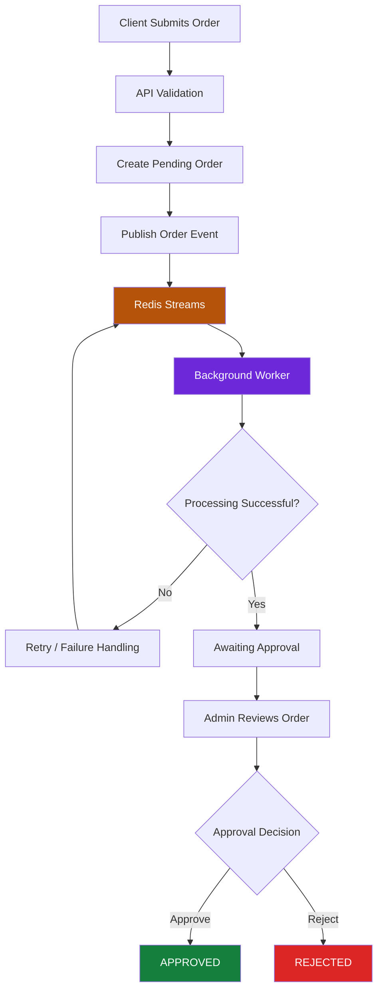

# Order Processing Workflow

## 1. Overview

This document describes the order lifecycle and processing workflow of the proposed event-driven order management system.

The workflow separates order submission, asynchronous processing and administrative approval to ensure controlled and reliable order handling.

## 2. Order Lifecycle

An order moves through the following logical states:

| Status | Description |
|---|---|
| PENDING | Order has been submitted |
| QUEUED | Order event is waiting for processing |
| PROCESSING | Background worker is processing the event |
| AWAITING_APPROVAL | Processing is complete and admin review is required |
| APPROVED | Administrator has approved the order |
| REJECTED | Administrator has rejected the order |
| FAILED | Processing encountered an unrecoverable error |

## 3. Order Submission

1. Client submits an order through the REST API.
2. API authenticates the request.
3. Request data is validated.
4. The system creates an order with PENDING status.
5. An order-created event is prepared for asynchronous processing.
6. The client receives an order reference and initial status.

## 4. Event Publishing

The event publishing component is responsible for communicating order-related events to Redis Streams.

Example event information:

- Event ID
- Order ID
- Event type
- Event timestamp
- Event version
- Correlation ID

Events should be published reliably. A transactional outbox approach can help prevent database updates and event publishing from becoming inconsistent.

## 5. Background Processing

Background workers consume events from Redis Streams.

Processing responsibilities:

1. Read available events.
2. Validate event structure.
3. Check for duplicate processing.
4. Retrieve the associated order.
5. Execute required business validations.
6. Update the order processing state.
7. Acknowledge successfully processed events.

## 6. Administrative Approval

After successful background processing, the order enters AWAITING_APPROVAL.

An authorized administrator can:

- View pending orders.
- Review order information.
- Approve an order.
- Reject an order.
- Review previous approval decisions.

Every administrative action should be recorded for audit purposes.

## 7. Failure Handling

Potential failure scenarios include:

- Invalid event data.
- Database connectivity issues.
- Worker interruption.
- Duplicate event delivery.
- Temporary infrastructure failures.

Proposed recovery strategies:

- Retry transient failures with controlled backoff.
- Use idempotency checks to prevent duplicate effects.
- Monitor pending and unprocessed events.
- Route repeatedly failing events to a dead-letter mechanism.
- Preserve error information for investigation.

## 8. State Management

Order state transitions should be validated before applying updates.

For example:

PENDING → QUEUED → PROCESSING → AWAITING_APPROVAL

From AWAITING_APPROVAL:

- APPROVED
- REJECTED

Invalid transitions should be rejected.

## 9. Reliability Considerations

- Idempotent event processing.
- Controlled retry policies.
- Redis consumer group management.
- Event acknowledgment after successful processing.
- Database transaction management.
- Audit history for approval actions.
- Monitoring and failure recovery.

## 10. Summary

The workflow demonstrates how asynchronous event processing and administrative approval can be combined to create a maintainable and scalable order management architecture.

## Implementation Status

This document describes a proposed workflow and design approach. It does not claim that the workflow has been implemented or deployed in production.

## 11. Order Lifecycle Diagram

